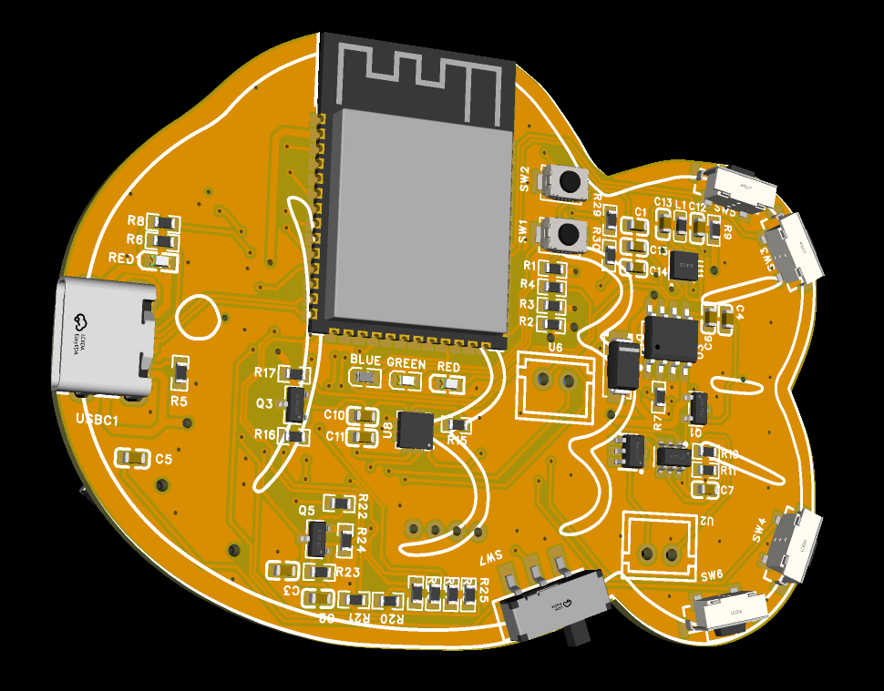

# Fishcrackers v1
What if your virtual pet only grew when you studied? Meet Fishcrackers v1, an AI-powered study companion and virtual pet. You’ll participate in Pomodoro sessions, quizzes, and streaks to maintain your pet's health and grow together.

This project was created in EasyEDA; to use it, go to the PCB folder—it is saved as an .epro file.

it is very compact, the pcb size is only 7x6cm because all components inside is built-in on pcb!

## Bill of Material
|No   |Comment                  |JLCPCB/EXTERNAL Part|Qty|Est Unit Price (USD)|Total Price (USD)|LINK                                                                                                                                                                                                                                             |
|-----|-------------------------|--------------------|---|--------------------|-----------------|-------------------------------------------------------------------------------------------------------------------------------------------------------------------------------------------------------------------------------------------------|
|1    |蓝灯停产                     |C125096             |20 |0.005               |0.10             |JLCPCB ASSEMBLY                                                                                                                                                                                                                                  |
|2    |CL10A106KP8NNNC          |C14663              |22 |0.012               |0.26             |JLCPCB ASSEMBLY                                                                                                                                                                                                                                  |
|3    |CL10A106KP8NNNC          |C15849              |20 |0.012               |0.24             |JLCPCB ASSEMBLY                                                                                                                                                                                                                                  |
|4    |CL10A106KP8NNNC          |C19702              |24 |0.012               |0.29             |JLCPCB ASSEMBLY                                                                                                                                                                                                                                  |
|5    |自弹式MICROSD卡(TF卡)卡座       |C41426929           |6  |0.150               |0.90             |JLCPCB ASSEMBLY                                                                                                                                                                                                                                  |
|6    |SS34                     |C53058727           |5  |0.025               |0.13             |JLCPCB ASSEMBLY                                                                                                                                                                                                                                  |
|7    |翠绿停产                     |C5252984            |5  |0.006               |0.03             |JLCPCB ASSEMBLY                                                                                                                                                                                                                                  |
|8    |AHW1608FE1R5KTF          |C19634003           |6  |0.040               |0.24             |JLCPCB ASSEMBLY                                                                                                                                                                                                                                  |
|9    |DMP1045U-7               |C177033             |16 |0.045               |0.72             |JLCPCB ASSEMBLY                                                                                                                                                                                                                                  |
|10   |FS8205                   |C5148694            |6  |0.035               |0.21             |JLCPCB ASSEMBLY                                                                                                                                                                                                                                  |
|11   |0603WAF1001T5E           |C25804              |52 |0.002               |0.10             |JLCPCB ASSEMBLY                                                                                                                                                                                                                                  |
|12   |0603WAF1001T5E           |C23186              |20 |0.002               |0.04             |JLCPCB ASSEMBLY                                                                                                                                                                                                                                  |
|13   |0603WAF1001T5E           |C4190               |20 |0.002               |0.04             |JLCPCB ASSEMBLY                                                                                                                                                                                                                                  |
|14   |0603WAF1001T5E           |C21190              |40 |0.002               |0.08             |JLCPCB ASSEMBLY                                                                                                                                                                                                                                  |
|15   |0603WAF1001T5E           |C22775              |20 |0.002               |0.04             |JLCPCB ASSEMBLY                                                                                                                                                                                                                                  |
|16   |0603WAF1001T5E           |C23345              |20 |0.002               |0.04             |JLCPCB ASSEMBLY                                                                                                                                                                                                                                  |
|17   |0603WAF1001T5E           |C25803              |40 |0.002               |0.08             |JLCPCB ASSEMBLY                                                                                                                                                                                                                                  |
|18   |0603红灯高亮                 |C2286               |20 |0.005               |0.10             |JLCPCB ASSEMBLY                                                                                                                                                                                                                                  |
|19   |3.9*3*2mm立贴轻触开关          |C720477             |8  |0.030               |0.24             |JLCPCB ASSEMBLY                                                                                                                                                                                                                                  |
|20   |轻触开关3*6*3.5侧按卧式带柱        |C410363             |12 |0.035               |0.42             |JLCPCB ASSEMBLY                                                                                                                                                                                                                                  |
|21   |MST-12D18G2卧式带柱编带        |C49023765           |5  |0.060               |0.30             |JLCPCB ASSEMBLY                                                                                                                                                                                                                                  |
|22   |不带固件通用型WI-FI+低功耗蓝牙MCU模组  |C2913202            |2  |2.100               |4.20             |JLCPCB ASSEMBLY                                                                                                                                                                                                                                  |
|23   |【插件】1X2P间距:2.54mm直插系列:XH |C5368775            |5  |0.020               |0.10             |JLCPCB ASSEMBLY                                                                                                                                                                                                                                  |
|24   |带电池反接保护 Guild的单节锂离子电池充电芯片|C42422118           |2  |0.120               |0.24             |JLCPCB ASSEMBLY                                                                                                                                                                                                                                  |
|25   |单节锂离子/锂聚合物电池保护IC         |C351410             |6  |0.030               |0.18             |JLCPCB ASSEMBLY                                                                                                                                                                                                                                  |
|26   |1.8V26DB                 |C2895290            |2  |0.220               |0.44             |JLCPCB ASSEMBLY                                                                                                                                                                                                                                  |
|27   |微型、低成本、PCM类D级放大器具有AB级性能  |C910544             |2  |0.350               |0.70             |JLCPCB ASSEMBLY                                                                                                                                                                                                                                  |
|28   |0.96 OLED                |EXTERNAL            |1  |1.67                |1.67             |https://shopee.co.id/Layar-OLED-0.96-Inch-I2C-Kuning-Biru-Putih-Tampilan-Jernih-Konsumsi-Daya-Rendah-Kompatibel-dengan-Arduino-i.1555409167.49905302568?extraParams=%7B%22display_model_id%22%3A390482753523%2C%22model_selection_logic%22%3A3%7D|
|29   |升降压型900mA1.8V~5.5V       |C15516              |2  |0.450               |0.90             |JLCPCB ASSEMBLY                                                                                                                                                                                                                                  |
|30   |TYPE-C母卧贴                |C165948             |2  |0.080               |0.16             |JLCPCB ASSEMBLY                                                                                                                                                                                                                                  |
|31   |TFP09-2-12B              |EXTERNAL            |1  |0.5                 |0.5              |https://shopee.co.id/Micro-SD-Card-Socket-Adapter-TF-9p-PCB-Reader-Connector-9pin-Push-Type-i.390846440.19931206539?extraParams=%7B%22display_model_id%22%3A191608514730%2C%22model_selection_logic%22%3A3%7D                                    |
|TOTAL (JLCPCB ASSEMBLY+EXTERNAL)|                         |                    |   |125.5                |                 |                                                                                                                                                                                                                                                 |
note: when you use JLCPCBA setup fees will be charged for each extended components.